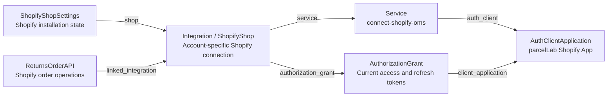
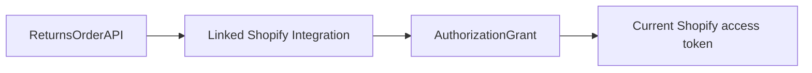
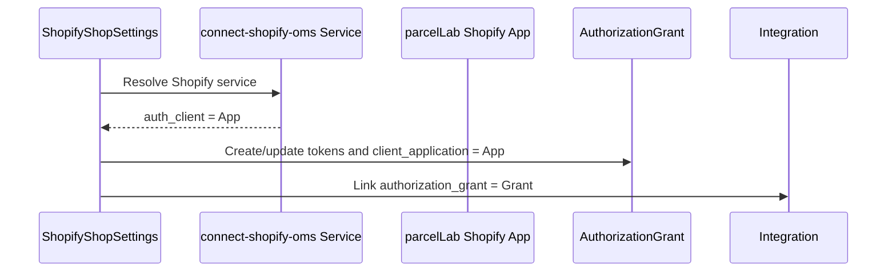
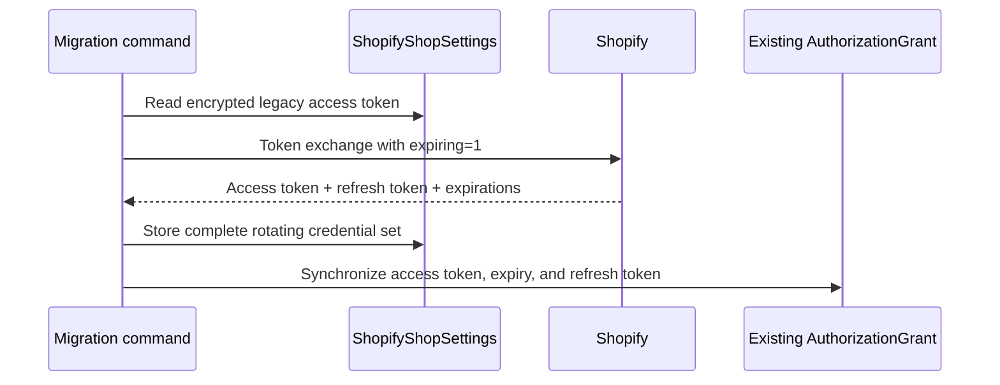
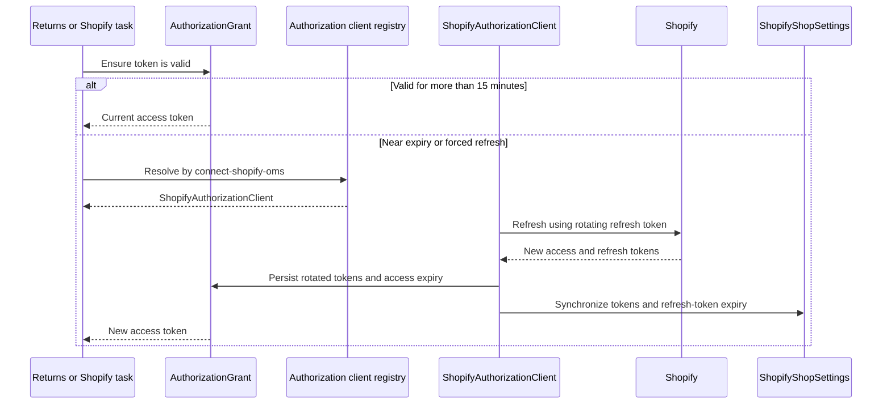

# Shopify integration and OAuth mental model

Last reviewed: 2026-08-14

This document explains how product-api represents a Shopify installation, where
Shopify credentials are stored, how Returns obtains an access token, and how the
expiring-offline-token branch changes token migration and refresh. It also records
the production observations made while reviewing this branch.

For the shorter admin installation procedure, see
[Shopify app account integration](shopify-app-account-integration.md).

## Executive summary

An installed Shopify shop is represented by several linked records rather than one
model:



The important credential path for Returns is:



Production was inspected during this review and every observed
`ShopifyShopSettings` had:

- a linked integration using the `connect-shopify-oms` service;
- a linked `AuthorizationGrant` on that integration;
- the same `AuthClientApplication` linked from both the service and the grant;
- the application name `parcelLab Shopify App`;
- the Shopify application client ID also present in
  `integrations/shopify/apps/shopify.app.prod.toml`.

That observed invariant means existing production shops have the grant required by
the expiring-token migration and by Returns' dynamic token lookup.

## Terminology

The codebase uses similar names for distinct concepts.

| Name | Model or class | Meaning |
| --- | --- | --- |
| parcelLab client | `config.models.Client` | A parcelLab brand/customer configuration. It is not an OAuth client. |
| Service | `service.models.Service` | A shared integration type. Shopify OMS uses the key `connect-shopify-oms`. |
| Integration | `config.models.Integration` | One account-specific installation of a service. |
| Shopify shop | `integrations.models.ShopifyShop` | A proxy over `Integration`, restricted to Shopify OMS integrations. |
| Shopify settings | `integrations.models.ShopifyShopSettings` | Shopify-specific installation state, shop metadata, token metadata, and links to the integration and parcelLab client. |
| OAuth application | `oauth.models.AuthClientApplication` | Metadata describing the external OAuth application for which grants were issued. |
| OAuth grant | `oauth.models.AuthorizationGrant` | Encrypted access token, refresh token, access-token expiry, and refresh health state. |
| Authorization client | `oauth.lib.client.AuthorizationClient` | Runtime Python code that refreshes a grant. |
| Shopify authorization client | `integrations.shopify.authorization_client.ShopifyAuthorizationClient` | Branch-specific runtime client that implements Shopify's shop-scoped refresh behavior. |

## OAuth artifacts and their responsibilities

### `Service`: the integration definition

The shared Shopify service is identified by `connect-shopify-oms`. An integration
points to this service to declare that it is a Shopify OMS connection.

`Service.auth_client` points to the default `AuthClientApplication` used when a new
grant is created. Production currently points this field to `parcelLab Shopify App`.

This relationship matters during installation because
`ShopifyShopSettings.get_or_create_authorization_grant()` starts with:

```python
auth_client = service.auth_client
```

It assigns that application to a new `AuthorizationGrant`.

### `AuthClientApplication`: OAuth application identity and metadata

`AuthClientApplication` is the database representation of an external OAuth
application. Its fields include the client ID, encrypted client secret, token
endpoints, grant type, and other OAuth configuration.

The production `parcelLab Shopify App` record appears to have been created
operationally through Django admin or the OAuth client-application API. No repository
migration or managed seed creates a record with that name or client ID, and the
checked-in service fixture has `auth_client: null`.

The Shopify CLI TOML file configures the application on Shopify's side. It does not
create the product-api `AuthClientApplication` row. The database row was created
separately and linked to the Shopify service.

The production application has a shop-specific-looking token endpoint. For the new
branch refresh flow this endpoint is metadata only: `ShopifyAuthorizationClient`
derives the correct endpoint from the integration's shop domain. Before this branch,
the custom Shopify runtime client and registry entry did not exist.

### `AuthorizationGrant`: rotating credential state

Every grant has a non-null `client_application` foreign key. It stores:

- the encrypted access token;
- the access-token expiry;
- the encrypted refresh token;
- invalid/error state and refresh timestamps;
- the OAuth application for which the credentials were issued.

The integration points to its current grant. Returns follows that relationship to
obtain the Shopify token.

### `ShopifyShopSettings`: installation and Shopify-specific state

`ShopifyShopSettings` stores data that does not fit the generic OAuth models:

- shop domain and Shopify metadata;
- installation and uninstall status;
- granted scopes;
- webhook and order-status-page state;
- access token and access-token expiry;
- refresh token and refresh-token expiry;
- links to the Shopify integration and parcelLab client.

The access and refresh credentials are duplicated between `ShopifyShopSettings` and
`AuthorizationGrant`. This is deliberate in the branch:

- Shopify-specific installation and scheduled-refresh code starts from settings;
- generic service and Returns code starts from the integration's grant;
- successful exchange or refresh synchronizes the two stores.

## How the OAuth application is automatically used

Once `connect-shopify-oms.Service.auth_client` points to `parcelLab Shopify App`, new
grant creation automatically copies that relationship:



For an existing grant, runtime refresh starts from the application already attached
to that grant. On this branch, `get_auth_client()` then selects the runtime Python
class by service key:

```python
application = integration.authorization_grant.client_application
client_class = AUTHORIZATION_CLIENT_REGISTRY.get(
    integration.service.key,
    AuthorizationClient,
)
```

`IntegrationsConfig.ready()` registers:

```text
connect-shopify-oms -> ShopifyAuthorizationClient
```

The database application and the Python registry therefore serve different roles:

- `AuthClientApplication` identifies the Shopify app and satisfies the grant's data
  model;
- `AUTHORIZATION_CLIENT_REGISTRY` chooses Shopify-specific refresh behavior at
  runtime;
- `SHOPIFY_APP_CLIENT_ID` and `SHOPIFY_APP_CLIENT_SECRET` provide the deployed
  Shopify app credentials used by that runtime behavior.

## Installation and initial token exchange

### Embedded Shopify app flow

The embedded app receives a Shopify session token and exchanges it at:

```text
https://<shop>.myshopify.com/admin/oauth/access_token
```

The branch requests an expiring offline token by sending:

- the deployed Shopify app client ID and secret from server settings;
- the session token as the subject token;
- the offline access-token type;
- `expiring=1`.

Shopify returns:

- `access_token`;
- `expires_in`;
- `refresh_token`;
- `refresh_token_expires_in`;
- `scope`.

The response is persisted to `ShopifyShopSettings`. If settings are already linked
to an integration with a grant, the same access token, access expiry, and refresh
token are synchronized into that grant.

Credentials alone do not complete installation. A newly seen shop starts in a
requested/pre-installation state. Applying the integration associates the parcelLab
account and client, creates or updates the grant, links the integration, and marks
the settings installed.

### Legacy production setup

Before expiring offline tokens, Shopify access tokens were effectively long-lived.
Existing integrations stored those tokens in `AuthorizationGrant`. When a Shopify
Returns Order API was linked to an integration, validation copied the grant token
into the Order API configuration. That copied token explains why Returns worked
without needing runtime refresh.

The production observation that Order API tokens were copied automatically from
Shopify integrations is also evidence that those integrations had grants: the copy
path reads `linked_integration.authorization_grant.access_token`.

## Migrating legacy offline tokens

`migrate_shopify_offline_tokens` selects legacy settings that have an access token
but no refresh token. For each selected shop it exchanges the legacy offline access
token for an expiring access/refresh pair.



For the verified production topology, this is the normal path: every installed
settings record already has a linked integration and grant.

## Runtime access-token refresh

Access tokens are considered near expiry within 15 minutes of `expires_at`.

When a linked grant exists, `ensure_authorization_grant()` returns the existing
grant while it is sufficiently valid. Otherwise it constructs the registered
`ShopifyAuthorizationClient` and refreshes the grant under the generic Redis refresh
lock.

The Shopify subclass changes three provider-specific details:

1. It uses `SHOPIFY_APP_CLIENT_ID` and `SHOPIFY_APP_CLIENT_SECRET` from server
   settings.
2. It derives the refresh endpoint from `integration.config["domain"]` rather than
   the endpoint stored on `AuthClientApplication`.
3. After saving rotated grant tokens, it synchronizes the token fields and
   refresh-token expiry back to `ShopifyShopSettings`.



The scheduled refresh command uses `ShopifyShopSettings.refresh_token_expires_at`
to rotate refresh tokens approaching their own expiry. Ordinary Returns requests
can also refresh an access token on demand through the linked grant.

## How Returns obtains the Shopify token

Returns has two historically related mechanisms.

### Stored Order API configuration

When a Shopify `ReturnsOrderAPI` is created or validated with a linked integration,
the integration grant's access token can be copied into the Order API configuration.
This supported legacy non-expiring tokens and remains a fallback in some management
and validation paths.

### Dynamic published-portal lookup

The expiring-token branch treats the linked grant as authoritative for published
portal configuration:

1. Load the database `ReturnsOrderAPI` and its linked Shopify integration.
2. Remove the possibly stale copied token from the published configuration.
3. Call `ensure_authorization_grant()` on the linked integration.
4. Refresh when necessary.
5. Inject the grant's current decrypted access token into the response.

This avoids requiring a portal republish every time Shopify rotates an access token.

## Verified production findings

The following are observations of current production data, not constraints enforced
by the database schema:

1. Every inspected `ShopifyShopSettings` has a linked `connect-shopify-oms`
   integration.
2. Every inspected linked integration has an `AuthorizationGrant`.
3. The Shopify service and its grants point to the same `AuthClientApplication`.
4. That application is named `parcelLab Shopify App`.
5. Its client ID matches the Shopify app client ID checked into the production
   Shopify CLI configuration.
6. Its stored token endpoint is shop-specific-looking, but the branch's custom
   runtime client does not use that endpoint for refresh.
7. The application record and service linkage are not reproduced by the repository's
   managed service seed; they appear to be operational database configuration.

## Risk assessment

### Existing production shops: low risk

The verified production relationship supplies exactly what migration and Returns
need. Token migration synchronizes an existing grant, and Returns obtains the
current token from that grant.

### Future installation drift: low but worth preventing

The schema permits settings or integrations without grants. Installation should not
mark a Shopify shop installed if grant creation failed, and automatic linking should
not treat a grantless integration as a complete installed connection.

### Environment/bootstrap drift: medium risk

Production has the `parcelLab Shopify App` database record and service linkage, but
the repository seed does not create them. A fresh environment can therefore create
the Shopify service with `auth_client = null`, preventing new grant creation.

A deployment check should verify that:

- the Shopify service has an auth client;
- the service application matches the application used by existing Shopify grants;
- its client ID matches `SHOPIFY_APP_CLIENT_ID`.

Do not compare or log the client secret.

### Partial persistence: medium-low risk

Token exchange writes `ShopifyShopSettings` and then synchronizes the grant. Those
writes are not currently wrapped in one database transaction. A grant validation or
save failure could leave settings with the new token pair while the grant still has
the old credentials. Because Returns uses the grant, this should be made atomic or
explicitly recoverable before broad migration.

### Published lookup failure behavior: operational risk

Published lookup removes the copied token before ensuring the grant. If grant
refresh raises, the method logs the exception and returns configuration without the
Shopify token. This avoids silently using a stale token, but the resulting Returns
failure should be observable and monitored.

## Assessment of the local hardening changes

The working tree currently contains uncommitted hardening changes created during
this investigation.

### Keep

- Make `apply_integration()` fail instead of marking a shop installed when no grant
  can be created.
- Prevent `ShopContext` from automatically marking a grantless integration
  installed.
- Model Shopify installation tests with a configured service-level application,
  matching production.

### Revise

- Do not automatically create missing grants during the token migration. The
  production audit found no such records, and silently repairing unexpected OAuth
  relationships increases migration scope.
- Replace automatic backfill with a read-only preflight that aborts before token
  exchange if an installed candidate has no integration, has no grant, or uses an
  unexpected application.
- Make settings-and-grant persistence atomic.

## Suggested preflight queries

The following snippets express the important checks. Run them in an appropriately
authorized Django shell and review the output without printing tokens or secrets.

```python
from django.conf import settings

from integrations.models import ShopifyShopSettings, ShopifyShopSettingsStatus
from service.models import Service

shopify_service = Service.objects.get(key="connect-shopify-oms")

missing_integration = ShopifyShopSettings.objects.filter(
    status=ShopifyShopSettingsStatus.INSTALLED,
    uninstalled=False,
    shop__isnull=True,
)

missing_grant = ShopifyShopSettings.objects.filter(
    status=ShopifyShopSettingsStatus.INSTALLED,
    uninstalled=False,
    shop__isnull=False,
    shop__authorization_grant__isnull=True,
)

unexpected_application = ShopifyShopSettings.objects.filter(
    status=ShopifyShopSettingsStatus.INSTALLED,
    uninstalled=False,
    shop__authorization_grant__isnull=False,
).exclude(
    shop__authorization_grant__client_application_id=shopify_service.auth_client_id,
)

assert not missing_integration.exists()
assert not missing_grant.exists()
assert not unexpected_application.exists()
assert shopify_service.auth_client is not None
assert shopify_service.auth_client.client_id == settings.SHOPIFY_APP_CLIENT_ID
```

## Source map

- `integrations/models.py`: `ShopifyShop`, `ShopifyShopSettings`, grant creation,
  installation linking, and grant synchronization.
- `integrations/shopify/services/token_exchange.py`: session exchange, legacy-token
  migration, direct refresh fallback, and token persistence.
- `integrations/shopify/authorization_client.py`: Shopify-specific grant refresh and
  settings synchronization.
- `integrations/apps.py`: registration of the Shopify runtime authorization client.
- `oauth/models.py`: `AuthClientApplication` and `AuthorizationGrant`.
- `oauth/lib/client.py`: generic refresh behavior, locking, persistence, and runtime
  authorization-client selection.
- `returns/models/models.py`: linked-integration token resolution and token copying
  into Returns Order API configuration.
- `returns/api.py`: dynamic access-token injection into published Returns portal
  configuration.
- `integrations/management/commands/migrate_shopify_offline_tokens.py`: migration
  from legacy offline tokens.
- `integrations/management/commands/refresh_shopify_offline_tokens.py`: scheduled
  rotation based on refresh-token expiry.
- `integrations/shopify/apps/shopify.app.prod.toml`: Shopify-side production app
  identity and configuration.
